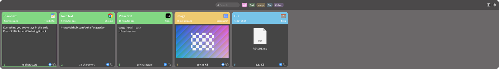
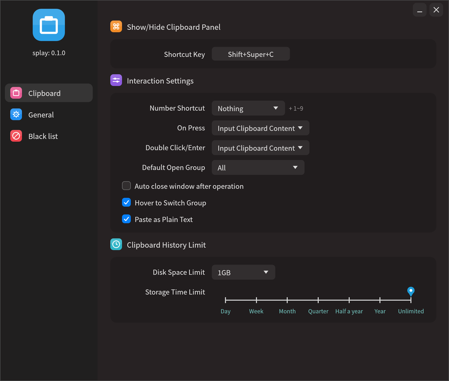

# Cliptray

[English](README.md)

Cliptray 记住你复制过的内容，并在屏幕底部铺成一排卡片。按 **Shift+Super+C**（Mac 上是 ⇧⌘C）打开这条卡片，选中一项，粘贴回刚才的窗口。

这是用 Rust 写的剪切板历史工具，交互参照 [iCopy](https://icopy.better365.cn)，运行在 Linux 和 macOS 上。





## 安装

**macOS（Apple Silicon）。** 从[最新 Release](https://github.com/duhaifeng/Cliptray/releases/latest) 下载 `Cliptray_0.1.1_macos_arm64.zip`，解压后打开 `Cliptray.app`。

如果打不开，是系统给下载文件加了隔离标记。在 `Cliptray.app` 所在目录执行下面的命令，然后再打开：

```bash
xattr -dr com.apple.quarantine Cliptray.app
```

**Debian / Ubuntu（amd64）。** 从 [v0.1.0 Release](https://github.com/duhaifeng/Cliptray/releases/tag/v0.1.0) 下载 `splay_0.1.0_amd64.deb`：

```bash
sudo dpkg -i splay_0.1.0_amd64.deb
```

包会装上 `/usr/bin/cliptray`、应用菜单入口，以及一份 XDG 自动启动项。systemd 用户单元会装上，但默认不启用，避免和自动启动项各拉起一个进程。

**从源码安装。** 需要 Rust 和 C 编译器（SQLite 随源码编译进去）。

```bash
cargo install --path .
cliptray doctor    # 检查会话、热键、剪切板、中日韩字体
cliptray daemon    # 前台运行
```

面板运行时需要 libxkbcommon、X11 或 Wayland 客户端库、OpenGL 或 EGL，以及一种中日韩字体（例如 `fonts-noto-cjk`）。没有这种字体时界面退回英文，中文会画成方框。

在 GNOME 的 Wayland 会话里，第一次安装后要注销再登录，用来抓全局热键的 Shell 扩展才会加载。

## 它记下什么

文本、富文本（HTML）、图片，以及文件、文件夹和一次复制的多个文件。同样的内容再复制一次，只是把那一条挪到最前，不会再新增一条。

收藏不受保留天数和图片磁盘上限的清理。可以按应用名忽略复制、限制保留天数，以及限制图片占用的磁盘。

## 面板

卡片条贴在屏幕底边，全宽、圆角、深色。顶上是搜索框、分类（All / Text / Image / File / Collect）、纯文本开关（T）和设置。每张卡片按类型着色，显示类型、相对时间和来源应用。底部是序号、字符数或文件大小，以及粘贴和拷贝按钮。文件已经不在时，显示灰色问号和红色文件名。

菜单栏图标在 macOS 上是状态栏项，在 Linux 上是 StatusNotifierItem。菜单是设置、剪切板、退出。设置有三页：剪切板、通用、黑名单。

| 按键或指针 | 动作 |
| --- | --- |
| ⌘F（Linux 为 Ctrl+F），或点击搜索框 | 搜索 |
| ↑ ↓、滚轮、悬停卡片 | 选择卡片。滚轮横向滚动 |
| ← →、Tab、Shift+Tab、悬停分类 | 切换分类 |
| Enter 或单击卡片 | 粘贴。`enter_action` 和 `click_action` 可以改成只拷贝 |
| 1…9 | 粘贴第 N 项（搜索框没有焦点时）。`number_modifier` 可以改成要按住 Alt 或 Ctrl |
| 卡片上的蓝 / 灰按钮 | 粘贴，或只拷贝 |
| Delete 或 Backspace | 删除，先确认 |
| 右键 | 粘贴、粘贴为纯文本或富文本、拷贝、拷贝（去换行）、拷贝（去换行和空格）、收藏、删除。右键分类标签可清空该分类，收藏会留下 |
| Esc，或点击面板外 | 关闭 |

界面语言跟随系统。macOS 上读首选语言。面板再次打开时回到上次的分类。

## 命令

```
cliptray daemon                 常驻进程，带菜单栏图标
cliptray toggle | show | hide   唤出或关闭面板
cliptray settings               打开设置
cliptray status | quit
cliptray list [--tag text] [--search 词] [--limit 20]
cliptray clear [--tag all] [--keep-favorites] --yes
cliptray config path | show | init [--force]   # --force 会先备份旧文件
cliptray doctor
```

## 配置

`~/.config/cliptray/config.toml`。缺的字段用默认值。`cliptray config show` 打印当前生效的值。

```toml
hotkey = "shift+super+c"      # cmd、command、meta、win 都是 super 的别名
paste_key = "ctrl+v"          # macOS 默认是 "super+v"；不少 Linux 终端要用 "ctrl+shift+v"
click_action = "paste"        # paste | copy | select（select 时双击才粘贴）
enter_action = "paste"        # paste | copy
double_click_action = "paste"
paste_plain_text = true       # 文本以纯文本写回；面板上的 T 可临时切换
trim_whitespace = false       # 写回时去掉首尾空行、全角/半角空格等空白
strip_styles = false          # 写回时去掉终端转义码和 HTML 样式，只留纯文本
hover_switch_group = true     # 悬停分类标签即切换
default_tag = "last"          # last | all | text | image | file | favorite
history_days = 0              # 0 = 不限制
disk_limit_mb = 1024          # 图片占用上限，0 = 不限制
blacklist = ["keepassxc"]     # 应用名精确匹配，不区分大小写。X11 用 WM_CLASS，macOS 用应用名
number_modifier = "none"      # none | alt | ctrl
confirm_delete = true
auto_hide = true              # 操作完成后关闭面板
show_status_item = true
launch_at_startup = false     # 下次登录时启动。macOS 写 LaunchAgent，Linux 写 XDG autostart
```

历史在 `~/.local/share/cliptray/`：`data.sqlite`、放图片的 `tempFiles/`、来源应用图标 `icons/`，以及上次分类 `last_tag`。

## Linux 与 macOS

| | X11 | Wayland | macOS |
| --- | --- | --- | --- |
| 全局热键 | Cliptray 自己抓取 | GNOME 用自带的 Shell 扩展 `cliptray@cliptray.local`。其他合成器不能抓取，把 Shift+Super+C 绑到 `cliptray toggle` | Carbon 热键。要自动粘贴，启动守护进程的程序需要辅助功能权限 |
| 粘贴 | XTest | GNOME 用 Mutter RemoteDesktop。其他合成器需要 `wtype` | 授予辅助功能权限后用 CGEvent。否则只写入剪切板 |
| 来源应用和黑名单 | `WM_CLASS` | 识别不到，黑名单不生效 | 应用名 |
| 剪切板监控 | 可以 | 需要合成器提供 data-control 协议 | 可以 |

`cliptray doctor` 会告诉你当前会话实际能做什么。GNOME Wayland 上，守护进程第一次启动时把扩展写到 `~/.local/share/gnome-shell/extensions/`。Shell 要到下一次登录才加载新扩展，在那之前热键不会生效。`CLIPTRAY_BACKEND=x11` 可以强制走 X11。

macOS 安装包用 `./package-mac.sh` 生成（`dist/Cliptray.app` 和 zip）。Linux amd64 的包用 `./package-deb.sh` 生成。

## 编译

```bash
cargo test
./package-deb.sh    # dist/cliptray_<版本>_amd64.deb
./package-mac.sh    # 在 macOS 上
```

`./restart.sh [--release]` 停掉本仓库编译出来的守护进程，重新编译并启动。

守护进程持有剪切板和历史库。面板是一个短命子进程：在 Linux 上，剪切板内容属于写入它的进程，那个进程一退出内容就没了，所以选中的项由守护进程写回并粘贴。面板只把选择交回去。

相对 iCopy 没有做的：快捷回复、剪切板堆栈、iCloud 备份、Excel 导入导出、主题、音效、双击修饰键或 Fn 热键、纵向列表，以及导出为图片、RTF 或 TXT。

## 许可证

[MIT](LICENSE)
